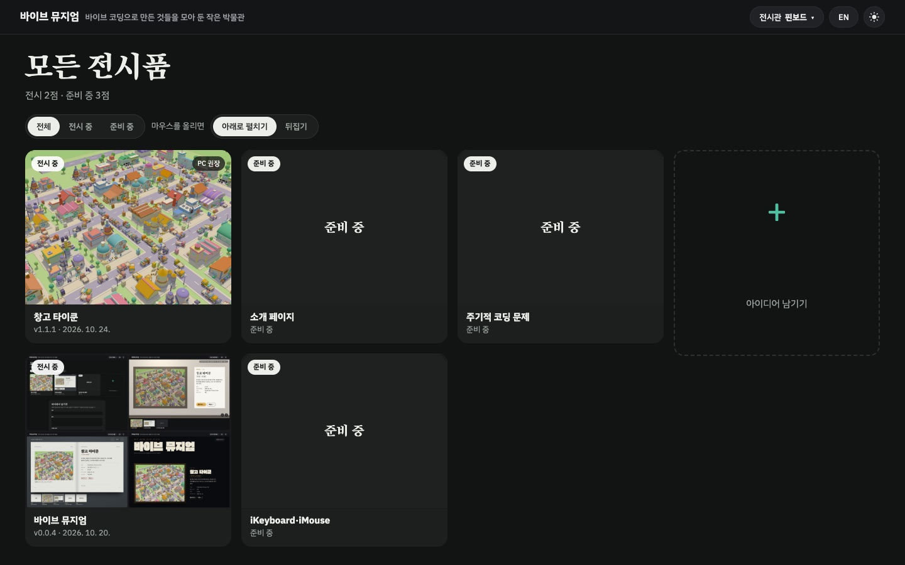
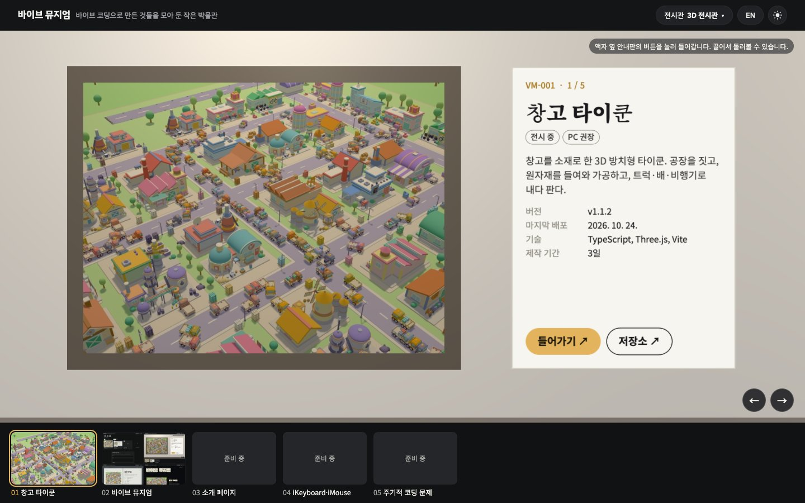
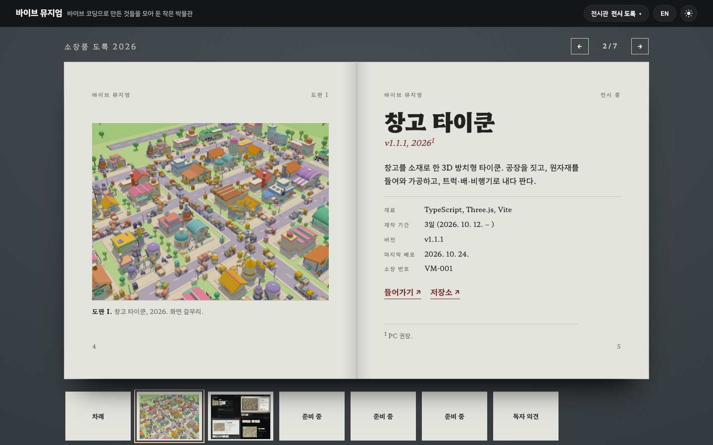
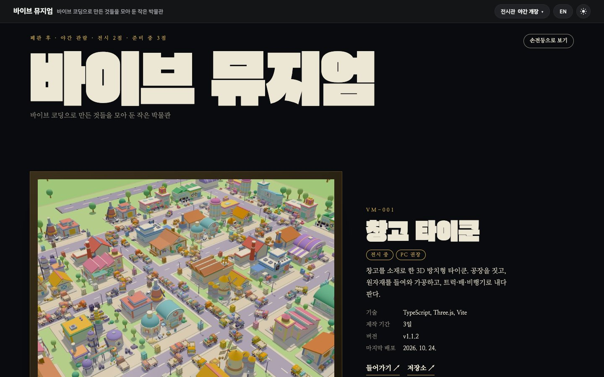

# Vibe Museum

[English](README.md) | **한국어**

바이브 코딩으로 만든 프로젝트들을 모아 전시하는 정적 사이트다. 주소는 <https://vibe-museum.yeonhyuk.me>.

같은 전시품을 네 가지 전시관으로 둘러볼 수 있고, 방문자가 위쪽 막대에서 고른다. 고른 전시관과 언어, 밝게/어둡게 설정은 브라우저에 기억한다.

| 핀보드 | 3D 전시관 |
|---|---|
|  |  |
| **전시 도록** | **야간 개장** |
|  |  |

| 전시관 | 파일 | 모습 |
|---|---|---|
| 핀보드 | `pinboard.html` | 썸네일을 엇갈려 쌓은 벽. 마우스를 올리면 설명이 펼쳐지거나 카드가 뒤집힌다 |
| 3D 전시관 | `hall.html` | 복도를 걷는다. 액자 옆 안내판의 버튼으로 들어가고, 아래 썸네일 띠로 이동한다 |
| 전시 도록 | `catalogue.html` | 한 장씩 넘기는 도록. 아래 띠에 모든 페이지가 있다 |
| 야간 개장 | `night.html` | 큰 글씨와 큰 그림. 어둡게 보기에서는 손전등으로 둘러볼 수 있다 |

- `index.html`은 지난번에 본 전시관으로, 처음이면 핀보드로 보낸다.
- `shared.js`가 한국어·영어 문구, 공통 머리말·꼬리말, 전시관 고르기 창, 밝게/어둡게 전환, 아이디어 입력 칸을 맡는다.
- 전시품 목록은 빌드 때 만든다(`data/exhibits.js`). 아래 "전시 목록".
- 아이디어 입력 칸은 `config.js`에 함수 주소(`ideasApi`)가 있을 때만 실제로 보낸다. 없으면 아직 열지 않았다는 문구만 띄운다.
- 남은 일은 [PLAN.md](PLAN.md)에 있다.

## 실행

Node 22 이상. 의존성이 없다.

```bash
npm run collect   # data/exhibits.js와 img/exhibits/를 만든다
python3 -m http.server 5191
```

- `npm test`: 전시 목록 만들기, 빌드, 아이디어 함수의 테스트
- `npm run build`: `dist/`를 만든다(collect 포함). 환경 변수 `CF_BEACON_TOKEN`(Cloudflare Web Analytics), `IDEAS_API_URL`, `TURNSTILE_SITE_KEY`, `SITE_URL`, `GOOGLE_SITE_VERIFICATION`, `NAVER_SITE_VERIFICATION`, `ADSENSE_CLIENT`, `ADSENSE_SLOT_INFEED`, `ADSENSE_SLOT_DISPLAY`는 모두 선택

## 전시 목록

`scripts/collect.mjs`가 루트 저장소(`BranKein/vibe-coding-playground`, 로컬에서는 이 저장소를 품은 폴더)를 읽는다.

- 전시 중: `.gitmodules`의 각 저장소 main에서 `deploy/exhibit.json`과 `deploy/site.json`을 읽는다. 가장 최근 `v*` 태그가 있어야 걸린다. 주소는 `https://<subdomain>.yeonhyuk.me`, 버전·날짜는 그 태그, 제작 기간은 첫 커밋부터 `v1.0.0`까지(없으면 최근 태그까지).
- 준비 중: `ideas/`에서 상태가 아이디어·보류·구현 중인 것. 이미 전시 중인 저장소는 뺀다. 박물관 자신도 `deploy/exhibit.json`이 있어 다른 프로젝트처럼 전시된다. 영어 화면용 줄은 `ideas/README.md`의 형식을 따른다.

`deploy/exhibit.json` 형식(예: vibe-warehouse-tycoon):

```json
{
  "title": { "ko": "창고 타이쿤", "en": "Warehouse Tycoon" },
  "blurb": { "ko": "한두 문장", "en": "One or two sentences" },
  "stack": ["TypeScript", "Three.js", "Vite"],
  "thumbnail": "deploy/thumbnail.jpg",
  "aspect": "4:3",
  "pcOnly": true
}
```

`id`(기본: 저장소 이름에서 `vibe-`나 `vive-`를 뺀 것)와 `aspect`(기본 4:3)는 생략할 수 있다. 썸네일이 없으면 자리표시 그림으로 걸린다.

## 배포

다른 프로젝트와 같은 구조다(루트 저장소 `docs/deploy.md`). `v*` 태그를 push하면 `.github/workflows/deploy.yml`이 테스트·빌드하고, vibe-infra의 `sites/vibe-museum`을 맞춘 뒤 S3에 올리고 CloudFront를 비운다.

- 다른 프로젝트가 배포를 마치면 `repository_dispatch`(`exhibit-updated`)를 보내고, 이 워크플로가 가장 최근 태그를 새 전시 데이터로 다시 빌드·배포한다. 매일 아침(06:17 KST)과 수동 실행도 같다. 첫 태그 전에는 아무것도 하지 않는다.
- Secrets: `AWS_ACCESS_KEY_ID`, `AWS_SECRET_ACCESS_KEY`(IAM 사용자 `deploy-vibe-museum`), `INFRA_REPO_TOKEN`
- Variables: `AWS_REGION`, `S3_BUCKET`, `CLOUDFRONT_DISTRIBUTION_ID`(설정됨). 선택: `CF_BEACON_TOKEN`, `GOOGLE_SITE_VERIFICATION`, `NAVER_SITE_VERIFICATION`, `IDEAS_API_URL`, `TURNSTILE_SITE_KEY`, `IDEAS_FUNCTION_NAME`, `ADSENSE_CLIENT`, `ADSENSE_SLOT_INFEED`, `ADSENSE_SLOT_DISPLAY`
- 링크 미리보기: 모든 페이지에 Open Graph 태그(`img/og.png`), 전시품마다 `e/<id>.html`.

## 검색 노출 (SEO)

빌드(`scripts/build.mjs`)가 만든다. 원본 HTML은 그대로다.

- 페이지마다 제목·설명(한국어 다음 영어)과 `<link rel="canonical">`. 대표 페이지는 핀보드이고, `index.html`의 canonical도 핀보드다.
- 네 전시관의 목록 자리(`#board`, `#strip`, `#book`, `#hall`)에 전시품 목록을 평범한 HTML로 미리 넣는다. 스크립트가 없어도 읽히고, 전시관 스크립트가 그 위에 다시 그린다.
- 핀보드에 JSON-LD(WebSite, 전시품 ItemList).
- `robots.txt`(모두 허용, 사이트맵 주소)와 `sitemap.xml`(네 전시관, 빌드한 날짜).
- 공유 페이지 `e/<id>.html`은 `noindex`(미리보기 태그는 그대로).
- 소유 확인: Variables `GOOGLE_SITE_VERIFICATION`, `NAVER_SITE_VERIFICATION`에 값을 넣으면 모든 페이지에 확인용 meta 태그가 붙는다(URL 접두어 방식). 비어 있으면 태그도 없다.

## 광고 (AdSense)

저장소 Variables가 있을 때만 붙는다. 하나도 없으면 빌드 결과의 페이지와 `config.js`가 광고를 넣기 전과 똑같다.

- `ADSENSE_CLIENT`: 게시자 ID(`ca-pub-…`, `pub-…`도 받아 `ca-pub-…`로 맞춘다). 있으면 핀보드·전시 도록·야간 개장의 `<head>`에 AdSense 스크립트가 붙고(사이트 확인에도 쓰인다), `config.js`에 `adsenseClient`와 `adsenseSlots`가 들어간다.
- `ADSENSE_SLOT_INFEED`: 핀보드의 광고 카드. 세 번째 전시품 뒤(그보다 적으면 마지막 전시품 뒤)에 카드 모양으로 들어간다.
- `ADSENSE_SLOT_DISPLAY`: 전시 도록과 야간 개장의 본문 아래, 꼬리말 위의 가로 상자.
- 광고 자리는 게시자 ID와 그 자리의 광고 단위 ID가 모두 있을 때만 생긴다. 모두 "광고 · Ad" 표시가 붙는다. 그리기는 `shared.js`(`ads()`)가 한다.
- 3D 전시관, 입구(`index.html`), 공유 페이지에는 광고가 없다.
- 광고가 채워지지 않거나(`data-ad-status="unfilled"`) 광고 차단기로 스크립트가 막히면 상자를 숨긴다.

## 방문자 아이디어 함수

`lambda/ideas/`(Node.js 22, 의존성 없음). AWS 자원(API Gateway, DynamoDB, SES, SSM 파라미터)은 vibe-infra의 `sites/vibe-museum-ideas`가 만들고, 코드는 배포 워크플로가 올린다(`IDEAS_FUNCTION_NAME`이 있을 때).

- `POST /ideas` → DynamoDB에 승인 대기로 저장, 운영자에게 승인·거절 메일, 이메일을 적었으면 확인 메일
- `/review`, `/confirm`, `/unsubscribe` → 링크는 확인 화면만 열고, 화면의 버튼(POST)이 처리한다. 링크 토큰은 서명되어 있고 한 번만 쓴다
- 승인하면 이 저장소에 `visitor-idea` 이슈(제목·설명만). 거절하면 지운다. 30일 동안 답이 없으면 DynamoDB TTL로 지워진다
- 매시간 `{ "task": "cleanup" }`: 24시간 안에 확인하지 않은 이메일을 지운다
- 배포 때 `{ "task": "built", "issues": [...] }`: `ideas/`에서 `- 출처: vibe-museum#N`이 있고 완료된 아이디어의 방문자에게 한 번 알리고 지운다
- Turnstile 비밀 키가 없으면(`unset`) 사람 확인을 건너뛴다. 요청 수 제한(주소마다 1시간에 5건)과 길이 제한(제목 100자, 설명 2,000자)은 늘 적용한다
- 테스트 메일: `node scripts/test-mail.mjs > /tmp/mail.json` 뒤 `aws sesv2 send-email --region ap-northeast-2 --cli-input-json file:///tmp/mail.json`
