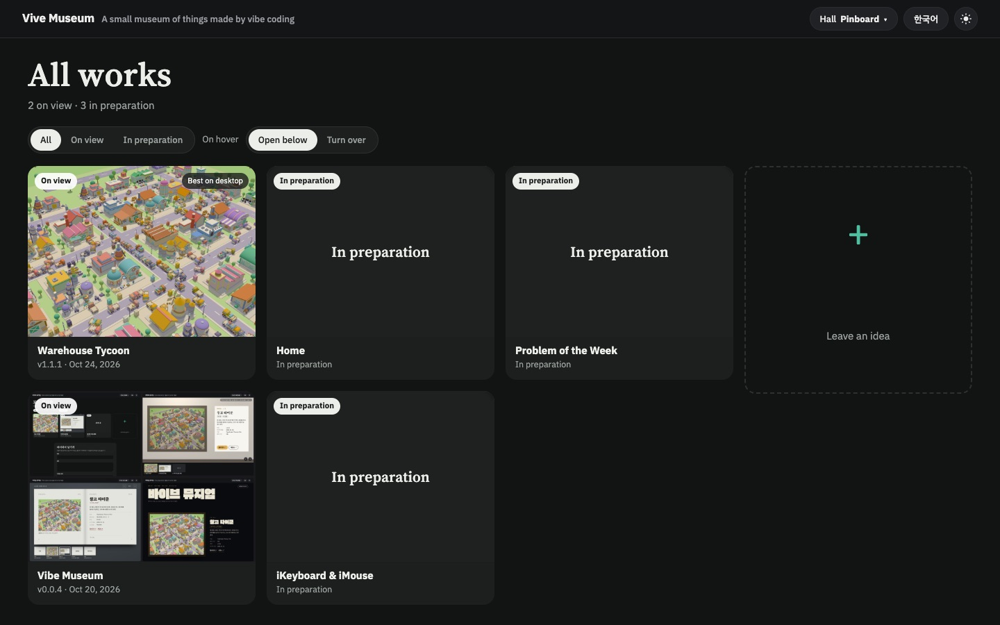
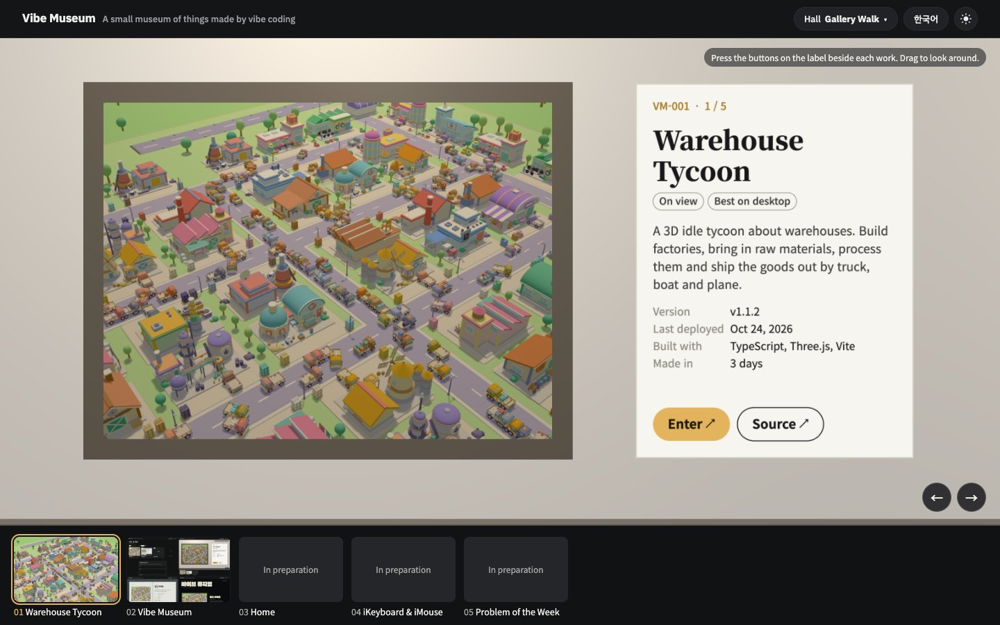
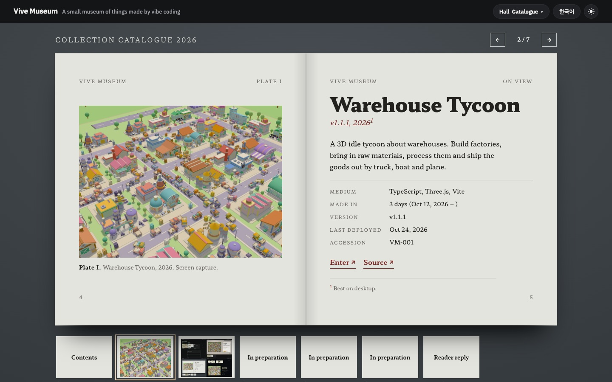
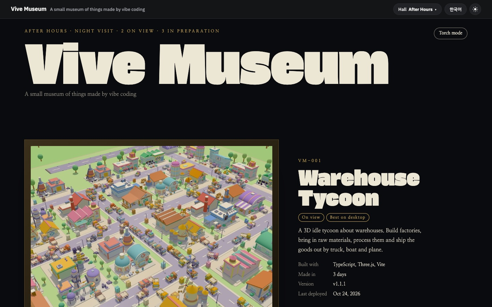

# Vibe Museum

**English** | [한국어](README.ko.md)

A static site that exhibits projects made by vibe coding. Live at <https://vibe-museum.yeonhyuk.me>.

The same exhibits can be viewed in four halls, and visitors pick one from the top bar. The chosen hall, language and light/dark setting are remembered in the browser.

| Pinboard | 3D Hall |
|---|---|
|  |  |
| **Catalogue** | **Night Opening** |
|  |  |

| Hall | File | What it looks like |
|---|---|---|
| Pinboard | `pinboard.html` | A staggered wall of thumbnails. Hovering opens the description below or flips the card |
| 3D Hall | `hall.html` | Walk down a corridor. Enter with the button on the label next to each frame; move with the thumbnail strip below |
| Catalogue | `catalogue.html` | A catalogue you turn page by page. Every page is in the strip below |
| Night Opening | `night.html` | Large type and large pictures. In dark mode you can look around with a flashlight |

- `index.html` sends visitors to the hall they last viewed, or to the pinboard on a first visit.
- `shared.js` handles the Korean/English text, the common header and footer, the hall picker, the light/dark toggle and the idea form.
- The exhibit list is generated at build time (`data/exhibits.js`). See "Exhibit list" below.
- The idea form only sends for real when `config.js` has the function address (`ideasApi`). Otherwise it just says the form is not open yet.
- Remaining work is in [PLAN.md](PLAN.md).

## Running

Node 22 or later. No dependencies.

```bash
npm run collect   # builds data/exhibits.js and img/exhibits/
python3 -m http.server 5191
```

- `npm test`: tests for the exhibit list, the build and the idea function
- `npm run build`: builds `dist/` (includes collect). The environment variables `CF_BEACON_TOKEN` (Cloudflare Web Analytics), `IDEAS_API_URL`, `TURNSTILE_SITE_KEY`, `SITE_URL`, `GOOGLE_SITE_VERIFICATION`, `NAVER_SITE_VERIFICATION`, `ADSENSE_CLIENT`, `ADSENSE_SLOT_INFEED` and `ADSENSE_SLOT_DISPLAY` are all optional

## Exhibit list

`scripts/collect.mjs` reads the root repository (`BranKein/vibe-coding-playground`; locally, the folder that contains this repository).

- On view: reads `deploy/exhibit.json` and `deploy/site.json` from the main branch of each repository in `.gitmodules`. A repository is shown only once it has a `v*` tag. The address is `https://<subdomain>.yeonhyuk.me` (`@` means `https://yeonhyuk.me`), the version and date come from the latest tag, and the build period runs from the first commit to `v1.0.0` (or to the latest tag if there is none).
- In preparation: ideas in `ideas/` whose status is idea, on hold or in progress. Repositories already on view are left out. The museum itself has a `deploy/exhibit.json` and is exhibited like any other project. The lines used for the English screens follow the format in `ideas/README.md`.

Format of `deploy/exhibit.json` (example: vibe-warehouse-tycoon):

```json
{
  "title": { "ko": "창고 타이쿤", "en": "Warehouse Tycoon" },
  "blurb": { "ko": "한두 문장", "en": "One or two sentences" },
  "stack": ["TypeScript", "Three.js", "Vite"],
  "thumbnail": "deploy/thumbnail.jpg",
  "aspect": "4:3",
  "pcOnly": true
}
```

`id` (default: the repository name without `vibe-` or `vive-`) and `aspect` (default 4:3) can be left out. Without a thumbnail the exhibit is hung with a placeholder picture.

## Deployment

Same structure as the other projects (`docs/deploy.md` in the root repository). Pushing a `v*` tag makes `.github/workflows/deploy.yml` test and build, reconcile `sites/vibe-museum` in vibe-infra, upload to S3 and invalidate CloudFront.

- When another project finishes deploying it sends a `repository_dispatch` (`exhibit-updated`), and this workflow rebuilds and redeploys the latest tag with fresh exhibit data. The same happens every morning (06:17 KST) and on manual runs. Nothing happens before the first tag.
- Secrets: `AWS_ACCESS_KEY_ID`, `AWS_SECRET_ACCESS_KEY` (IAM user `deploy-vibe-museum`), `INFRA_REPO_TOKEN`
- Variables: `AWS_REGION`, `S3_BUCKET`, `CLOUDFRONT_DISTRIBUTION_ID` (set). Optional: `CF_BEACON_TOKEN`, `GOOGLE_SITE_VERIFICATION`, `NAVER_SITE_VERIFICATION`, `IDEAS_API_URL`, `TURNSTILE_SITE_KEY`, `IDEAS_FUNCTION_NAME`, `ADSENSE_CLIENT`, `ADSENSE_SLOT_INFEED`, `ADSENSE_SLOT_DISPLAY`
- Link previews: every page has Open Graph tags (`img/og.png`), and each exhibit has `e/<id>.html`.

## Search (SEO)

Generated by the build (`scripts/build.mjs`). The source HTML stays as it is.

- Each page gets a title and description (Korean, then English) and a `<link rel="canonical">`. The main page is the pinboard, and `index.html` also points its canonical to the pinboard.
- The list slots of the four halls (`#board`, `#strip`, `#book`, `#hall`) are prefilled with the exhibit list as plain HTML. It reads without scripts, and the hall scripts redraw over it.
- JSON-LD on the pinboard (WebSite, an ItemList of exhibits).
- `robots.txt` (allow all, sitemap address) and `sitemap.xml` (the four halls, build date).
- The share pages `e/<id>.html` are `noindex` (preview tags stay).
- Ownership verification: put values in the Variables `GOOGLE_SITE_VERIFICATION` and `NAVER_SITE_VERIFICATION` and every page gets the verification meta tag (URL-prefix method). Empty means no tag.

## Ads (AdSense)

Added only when the repository Variables are set. With none of them, the built pages and `config.js` are exactly as they were before ads.

- `ADSENSE_CLIENT`: publisher ID (`ca-pub-…`; `pub-…` is accepted and normalized to `ca-pub-…`). When set, the AdSense script is added to the `<head>` of the pinboard, catalogue and night opening (it also serves site verification), and `config.js` gets `adsenseClient` and `adsenseSlots`.
- `ADSENSE_SLOT_INFEED`: an ad card on the pinboard, placed after the third exhibit (or after the last one if there are fewer).
- `ADSENSE_SLOT_DISPLAY`: a horizontal box below the content of the catalogue and night opening, above the footer.
- An ad slot appears only when both the publisher ID and that slot's ad unit ID are set. Every slot is labelled "광고 · Ad". Drawing is done by `shared.js` (`ads()`).
- The 3D hall, the entrance (`index.html`) and the share pages have no ads.
- If an ad is not filled (`data-ad-status="unfilled"`) or an ad blocker stops the script, the box is hidden.

## Visitor idea function

`lambda/ideas/` (Node.js 22, no dependencies). The AWS resources (API Gateway, DynamoDB, SES, SSM parameters) are created by `sites/vibe-museum-ideas` in vibe-infra, and the deploy workflow uploads the code (when `IDEAS_FUNCTION_NAME` is set).

- `POST /ideas` → saved to DynamoDB awaiting approval; the operator gets an approve/reject email, and the visitor gets a confirmation email if they left an address
- `/review`, `/confirm`, `/unsubscribe` → links only open a confirmation screen, and its button (POST) does the work. Link tokens are signed and single-use
- Approving opens a `visitor-idea` issue in this repository (title and description only). Rejecting deletes it. Anything left unanswered for 30 days is removed by a DynamoDB TTL
- Every hour `{ "task": "cleanup" }`: deletes emails not confirmed within 24 hours
- On deploy `{ "task": "built", "issues": [...] }`: notifies, once, the visitors of completed ideas in `ideas/` that carry `- 출처: vibe-museum#N`, then deletes them
- Without a Turnstile secret key (`unset`) the human check is skipped. The rate limit (5 per hour per address) and length limits (title 100 characters, description 2,000 characters) always apply
- Test mail: `node scripts/test-mail.mjs > /tmp/mail.json`, then `aws sesv2 send-email --region ap-northeast-2 --cli-input-json file:///tmp/mail.json`
